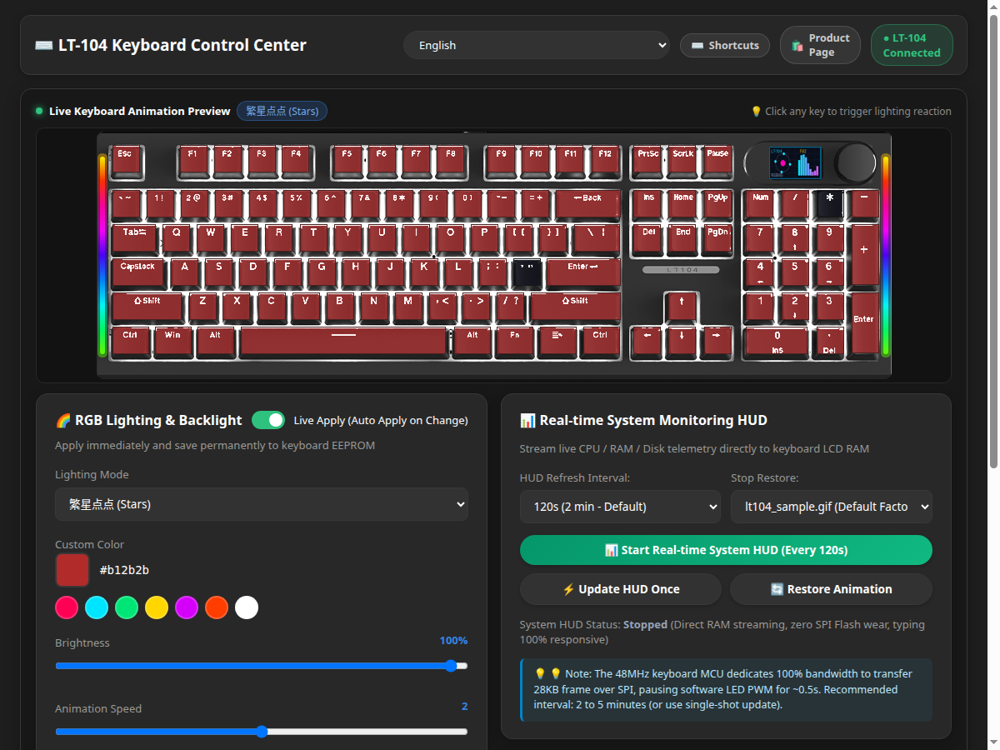
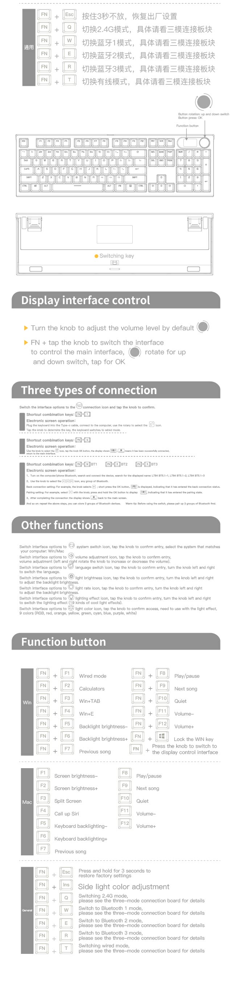
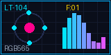
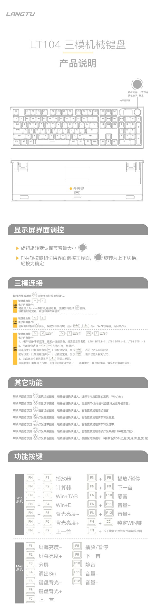

# LangTu LT-104 Keyboard Linux Driver & Control Suite

[](https://github.com/iiaiiappa/lt104-keyboard-linux/releases/tag/v1.0.0)
[](https://www.gnu.org/licenses/gpl-3.0)
[](https://www.python.org/)
[](https://kernel.org/)
[](#-package-installation-deb-rpm-appimage)
[](https://gnome.pages.gitlab.gnome.org/libadwaita/)
[](https://extensions.gnome.org/)

**A 100% native Linux driver, Web UI, Desktop GUI (GTK4/Libadwaita), CLI tool, and GNOME Shell Extension for the LangTu (狼途) LT-104 RGB Mechanical Keyboard with 160×80 TFT LCD Screen (`USB ID 0c45:8009 Microdia/SONiX`).**

Reverse-engineered from the official Windows `DeviceDriver.exe` and USB protocol dumps. Runs entirely on native Linux USB HID interfaces without Wine, virtual machines, or proprietary Windows background daemons.

---

## 📸 Screenshots & Showcase

<div align="center">

### Modern Dark-Mode Web Dashboard (`:8989`)


<br/><br/>

### Hardware Shortcuts Reference & TFT LCD Streaming
| Official High-Resolution Shortcuts & Functions Reference Chart | 160×80 LCD Frame Stream Sample |
| :---: | :---: |
| <a href="screenshots/shortcuts_reference_chart.jpg" target="_blank"></a> |  |

</div>

---

## 📖 Hardware Shortcuts Reference & TFT LCD Streaming Full Manual

### 1. 📡 Three-Mode Connectivity & Wireless Pairing (三模连接)

The LangTu LT-104 supports 3 independent connection interfaces. You can switch modes either via hardware key shortcuts or using the physical rotary knob on the TFT LCD display menu:

| Connection Mode | Shortcut | Rotary Knob / TFT Screen Navigation | Device Name / Notes |
| :--- | :--- | :--- | :--- |
| **Type-C Wired** | `Fn + T` | Rotate knob to `[Wired/USB]` icon → Short press to confirm | Connect USB-C cable to PC (`USB ID 0c45:8009`). Immediate plug-and-play. |
| **2.4G Wireless** | `Fn + Q` | Rotate knob to `[2.4G]` icon → Short press to confirm | Plug 2.4G wireless dongle into PC (`USB ID 05ac:024f`). Hold `Fn + Q` for 3–5s to enter fast pairing mode if reconnecting. |
| **Bluetooth 1 (BT1)** | `Fn + W` | Rotate knob to `[BT1]` icon → Short press (reconnect) / Long press (pairing) | Broadcasts as `LT84 BT5.1-1` / `LT104 BT5.1`. Long-press 3–5s until screen icon flashes rapidly to pair. |
| **Bluetooth 2 (BT2)** | `Fn + E` | Rotate knob to `[BT2]` icon → Short press (reconnect) / Long press (pairing) | Broadcasts as `LT84 BT5.1-2` / `LT104 BT5.1`. Multi-host pairing with phone/tablet/laptop. |
| **Bluetooth 3 (BT3)** | `Fn + R` | Rotate knob to `[BT3]` icon → Short press (reconnect) / Long press (pairing) | Broadcasts as `LT84 BT5.1-3` / `LT104 BT5.1`. Instant 1-key switching across up to 3 paired BT devices. |

> **Pairing & Reconnection Tip:**
> - **Reconnect (回连)**: Short press knob on Bluetooth icon or short press `Fn + W / E / R`.
> - **New Pairing (配对)**: Long press knob (3–5s) on Bluetooth icon or long press `Fn + W / E / R` (3–5s) until the screen displays the pairing animation.

---

### 2. 🎛️ Rotary Knob & TFT LCD Screen Controls (旋钮与屏幕调控)

The physical rotary knob next to the TFT display operates in two distinct modes:

- **Mode Toggle**:
  - **Press and hold knob for 3 seconds** OR press **`Fn + Knob Press`** to toggle between **Volume Adjustment Mode** and **Display Menu Mode**.
- **Default Mode (Volume Control)**:
  - **Rotate Clockwise**: Volume Up
  - **Rotate Counter-Clockwise**: Volume Down
  - **Short Press Knob**: Mute / Unmute
- **Display Menu Mode (Screen Navigation)**:
  - **Rotate Knob**: Scroll through menu options (up / down)
  - **Short Press Knob**: Confirm / enter submenu or save setting
  - **Menu Options Available on Screen**:
    1. **Lighting Effect (灯光效果)**: Rotate to switch between 19/20 dynamic backlight effects.
    2. **Light Color (灯光颜色)**: 9 solid color presets (RGB, Red, Orange, Yellow, Green, Cyan, Blue, Purple, White).
    3. **Light Brightness (灯光亮度)**: Stepwise backlight brightness adjustment.
    4. **Light Speed (灯光速率)**: Dynamic animation playback speed.
    5. **Language (语言切换)**: Toggle between 中文 and English.
    6. **System Mode (系统切换)**: Toggle between `Win` and `Mac` layouts.
    7. **Custom GIF Animation (动画切换)**: Display internal uploaded 160×80 GIF/Image.

---

### 3. ⌨️ Complete Hardware Shortcuts Reference (功能按键与快捷键对照表)

#### 🛠️ General / System Combinations (通用快捷键)

| Shortcut | Function Description (功能说明) |
| :--- | :--- |
| **`Fn + Esc` (Hold 3s)** | **Factory Reset**: Restores keyboard EEPROM, lighting, and pairing configurations to factory defaults (长按3秒恢复出厂设置) |
| **`Fn + Ins`** | **Side Light Bar**: Cycles through side edge lighting modes and 9 preset colors (侧边灯效与单色切换) |
| **`Fn + Win`** | **Win Lock**: Toggles Windows key lock on/off to prevent accidental presses during gaming (锁定/解锁 WIN 键) |
| **`Fn + Knob Press`** | **Knob Mode Toggle**: Alternates between Volume control and TFT screen menu navigation (切换旋钮音量/屏幕菜单调控) |
| **`Fn + Q`** | **Switch to 2.4G Wireless Mode** (切换 2.4G 模式，长按配对) |
| **`Fn + W`** | **Switch to Bluetooth 1 (BT1)** (切换 蓝牙 1 模式，长按配对) |
| **`Fn + E`** | **Switch to Bluetooth 2 (BT2)** (切换 蓝牙 2 模式，长按配对) |
| **`Fn + R`** | **Switch to Bluetooth 3 (BT3)** (切换 蓝牙 3 模式，长按配对) |
| **`Fn + T`** | **Switch to USB Wired Mode** (切换 Type-C 有线模式) |

#### 🪟 Windows Mode Shortcuts (`Fn + F1` – `Fn + F12`)

| Key Combination | Windows Action | Linux Equivalent / Function |
| :--- | :--- | :--- |
| **`Fn + F1`** | Default Media Player (播放器) | `XF86AudioMedia` / Launches default music player |
| **`Fn + F2`** | Calculator (计算器) | `XF86Calculator` / Launches GNOME Calculator |
| **`Fn + F3`** | Task View (`Win + Tab`) | Opens GNOME Shell Overview / Workspace switcher |
| **`Fn + F4`** | File Explorer (`Win + E`) | Opens Nautilus File Manager (`XF86Explorer`) |
| **`Fn + F5`** | Backlight Brightness - (背光亮度-) | Decreases keyboard RGB backlight intensity |
| **`Fn + F6`** | Backlight Brightness + (背光亮度+) | Increases keyboard RGB backlight intensity |
| **`Fn + F7`** | Previous Track (上一首) | `XF86AudioPrev` |
| **`Fn + F8`** | Play / Pause (播放/暂停) | `XF86AudioPlay` / `XF86AudioPause` |
| **`Fn + F9`** | Next Track (下一首) | `XF86AudioNext` |
| **`Fn + F10`** | Mute Audio (静音) | `XF86AudioMute` |
| **`Fn + F11`** | Volume - (音量-) | `XF86AudioLowerVolume` |
| **`Fn + F12`** | Volume + (音量+) | `XF86AudioRaiseVolume` |

#### 🍎 Mac Mode Shortcuts (Direct `F1` – `F12` Function Keys)

When switched to Mac Mode (via on-screen menu `System -> Mac`):

| Key | macOS Action | Linux / Desktop Mapping |
| :--- | :--- | :--- |
| **`F1`** | Screen Brightness - (屏幕亮度-) | `XF86MonBrightnessDown` |
| **`F2`** | Screen Brightness + (屏幕亮度+) | `XF86MonBrightnessUp` |
| **`F3`** | Mission Control / Split Screen (分屏) | GNOME Activities / Multi-window view |
| **`F4`** | Call up Siri (唤出 Siri) | Voice assistant / Custom shortcut |
| **`F5`** | Keyboard Backlight - (键盘背光-) | `XF86KbdBrightnessDown` |
| **`F6`** | Keyboard Backlight + (键盘背光+) | `XF86KbdBrightnessUp` |
| **`F7`** | Previous Track (上一首) | `XF86AudioPrev` |
| **`F8`** | Play / Pause (播放/暂停) | `XF86AudioPlay` |
| **`F9`** | Next Track (下一首) | `XF86AudioNext` |
| **`F10`** | Mute Audio (静音) | `XF86AudioMute` |
| **`F11`** | Volume - (音量-) | `XF86AudioLowerVolume` |
| **`F12`** | Volume + (音量+) | `XF86AudioRaiseVolume` |

---

### 4. 📺 Official Manual & High-Resolution Scan Reference

<div align="center">

| Official User Manual & Connectivity Guide | Hardware Shortcuts & Function Reference Chart |
| :---: | :---: |
| <a href="screenshots/lt104_manual_overview.jpg" target="_blank"></a> | <a href="screenshots/shortcuts_reference_chart.jpg" target="_blank"></a> |

</div>

---

### 5. 🐧 Automatic Linux Kernel Keymap Correction (Dongle Mode `05ac:024f`)

In 2.4G wireless dongle mode, the keyboard reports as `USB VID:PID = 05ac:024f` ("USB Dongle"). Because this matches Apple's vendor ID, the Linux kernel binds `hid_apple`. With `hid_apple fnmode=2`, the modifier keys are automatically corrected at the kernel level without breaking F1–F12:

| Physical Key | HID Scan Code | Default Kernel Key | Desired Corrected Key |
| :--- | :--- | :--- | :--- |
| **Left Win** | `0x700e3` | `KEY_LEFTALT` | **`KEY_LEFTMETA`** |
| **Left Alt** | `0x700e2` | `KEY_LEFTMETA` | **`KEY_LEFTALT`** |
| **Right Alt** | `0x700e6` | `KEY_RIGHTMETA` | **`KEY_RIGHTALT`** |
| **Menu / App** | `0x70065` | `KEY_COMPOSE` | **`KEY_COMPOSE`** |

This repository includes:
1. `/etc/udev/hwdb.d/99-lt104-win.hwdb` for kernel-level hwdb keycode remapping.
2. `/etc/udev/rules.d/99-lt104-win-remap.rules` & `/usr/local/bin/lt104-remap-keys.py` utilizing `EVIOCSKEYCODE_V2` ioctl on device connection to ensure modifier correction across all TTYs, desktop environments, and raw evdev applications.

## 🌟 Key Features

### 1. 🌈 Full RGB Backlight Control & EEPROM Storage
- **22 Lighting Modes**: Static, Single Light, Stars, Breathing, Rainbow Wave, Neon Glow, River Stream, Ripple Spread, Backlight Off, and more.
- **Custom Color Dialog & 7 Quick Presets**: Precise RGB HEX selection with color picker and quick preset buttons.
- **Hardware-Level Persistence**: Commands write directly to the keyboard's internal non-volatile EEPROM memory (`0x04 0xF0`). Lighting preferences survive computer power-offs, reboots, and unplugging without any software running.

### 2. 🕒 TFT Clock Calibration & 12-Hour Automated Scheduler
- **One-Click Precision Time Sync**: Immediately synchronizes PC system time to the keyboard's internal hardware RTC with sub-second accuracy.
- **Background Auto-Sync Service**: Automated systemd user timer (`lt104-clock-sync.timer`) periodically calibrates the keyboard clock every 12 hours.
- **Zero Backlight Interruption**: Clock packets are only 10 bytes and transfer in `< 1ms`, keeping the keyboard backlight 100% solid and flicker-free.

### 3. 📊 Real-Time Hardware Telemetry HUD
- **Live System Stats**: Displays CPU load percentage, RAM usage (GB & %), Root Disk usage (%), System Time, and Hostname on the keyboard's 160×80 LCD.
- **Direct RAM Buffer Streaming**: Writes directly to the keyboard's volatile LCD frame buffer. **Zero SPI Flash wear** and **no flash memory degradation**.
- **Adjustable Refresh Interval**: Choose from 5s, 10s, 20s (default), 30s, 60s, 120s (2 min), or 300s (5 min).
- **Single-Shot On-Demand Trigger**: Includes a `⚡ Update HUD Once` button in both Web and GTK interfaces to query and inspect hardware metrics whenever needed without continuous background cycling.

### 4. 📺 Custom LCD Image & GIF Animation Uploader
- **GIF & Static Image Support**: Converts any animated GIF, PNG, JPEG, or WebP to 160×80 RGB565 Little-Endian format.
- **Hardware Flow Control**: Respects keyboard MCU SPI write cycles with hardware ACK synchronization on Endpoint `0x84`, preventing packet drops and tearing.
- **Hardware Slot 1 Flash Storage**: Uploaded animations are committed to internal on-board storage and loop continuously even without an active PC connection.

### 5. 💾 Cross-Session Configuration Persistence
- All settings (lighting mode, color, brightness, speed, HUD refresh interval, language) are automatically remembered across sessions in `~/.config/lt104/config.json` and browser `localStorage`.
- Settings are restored automatically whenever you launch the Web Console, the Desktop App, or the GNOME Shell extension.

### 6. 🌐 Multilingual Internationalization (i18n)
Full native localization across all interfaces in 9 Ubuntu desktop languages:
- **English**, **简体中文**, **繁體中文**, **日本語**, **한국어**, **Deutsch**, **Français**, **Español**, **Русский**.

---

## 📦 Package Installation (.deb, .rpm, AppImage)

Pre-built standalone installation packages are available under [**Releases (v1.0.0)**](https://github.com/iiaiiappa/lt104-keyboard-linux/releases/tag/v1.0.0).

### 🐧 Debian / Ubuntu / Linux Mint (`.deb`)
Download and install the Debian binary package with automatic dependency resolution:
```bash
# 1. Download the release package
wget https://github.com/iiaiiappa/lt104-keyboard-linux/releases/download/v1.0.0/lt104-keyboard-linux_1.0.0_all.deb

# 2. Install via apt
sudo apt install ./lt104-keyboard-linux_1.0.0_all.deb

# 3. Launch from terminal or Application menu
lt104             # Launches GTK4 Desktop application
lt104-web         # Starts Web Control Panel on http://127.0.0.1:8989
lt104-cli status  # Check keyboard connection status
lt104-remap-keys  # Manually trigger key remapping (runs automatically in background)
```

> **✨ Automatic & Persistent Key Remapping Included**:
> Installing the `.deb` package or running `./setup.sh install` automatically configures systemd-hwdb, udev hotplug rules, and a systemd boot service (`lt104-remap.service`) ensuring expected keyboard shortcuts on Ubuntu / GNOME:
> - **Left Alt + Tab** → One horizontal row window switcher (no workspaces)
> - **Right Alt + Tab** → Exactly identical: one horizontal row window switcher (no workspaces)
> - **Left Win + Tab** → Switcher with workspaces
> - **Left Win (alone)** → Opens GNOME Menu / ArcMenu
> - **Menu Key** → Context Menu / Compose key

### 🔴 Fedora / RHEL / openSUSE (`.rpm`)
Build and install via rpmbuild:
```bash
# Build binary RPM package using provided spec file:
rpmbuild -ba packaging/lt104.spec

# Install the generated RPM:
sudo dnf install ~/rpmbuild/RPMS/noarch/lt104-keyboard-linux-1.0.0-1.*.noarch.rpm
```

### 🚀 Universal AppImage (All Linux Distributions)
Run directly without installing system libraries:
```bash
# 1. Make executable
chmod +x LT104-Keyboard-Center-1.0.0-x86_64.AppImage

# 2. Run GTK4 Desktop App
./LT104-Keyboard-Center-1.0.0-x86_64.AppImage

# 3. Or run the Web Panel
./LT104-Keyboard-Center-1.0.0-x86_64.AppImage web
```

### 🏹 Arch Linux / Manjaro (PKGBUILD)
```bash
cd packaging/arch
makepkg -si
```

---

## 🖥️ Four Ways to Control Your Keyboard

| Interface | Description | Launch Command |
|---|---|---|
| **Web Console** | Modern dark-mode web dashboard running on port `8989` | `python3 web_app.py 8989` (or `lt104-web`) |
| **Desktop App** | Native GNOME GTK4 + Libadwaita application with toast notifications | `python3 lt104_gtk.py` (or `lt104`) |
| **GNOME Extension** | Top bar tray menu with dynamic connection mode status, Bluetooth battery %, auto-hiding cable-only items, clock sync, RGB presets, and HUD | `gnome-extensions enable lt104-indicator@theforwardway.com` |
| **CLI Tool** | Command-line interface for scripts, crontabs, and shortcuts | `python3 lt104_cli.py --help` (or `lt104-cli`) |

---

## 🔧 Hardware Architecture & Technical Notes

### Device Identifiers
- **USB Vendor ID (VID)**: `0c45` (Microdia / SONiX Technology Co., Ltd.)
- **USB Product ID (PID)**: `8009` (LT104 Gaming Keyboard)
- **Interface 0 & 1**: Standard USB HID Keyboard & Consumer Keys (`/dev/input/event*`)
- **Interface 2**: LCD Interrupt / Bulk Out Endpoint (`/dev/hidraw*` via Endpoint `0x03` Out & `0x84` In)
- **Interface 3**: Vendor Control Endpoint (`USBDEVFS_CONTROL` / HID Set_Report on Endpoint 0)

### Why Does the Backlight Turn Off for 1 Second During Full HUD Updates?
The LangTu LT-104 is driven by a cost-effective single-core 48MHz ARM Cortex-M0 MCU (SONiX SN32F240B series).
1. **Matrix PWM Multiplexing**: The 104-key RGB backlight is software-multiplexed using high-frequency timer interrupts (10–20 kHz).
2. **Frame Size**: One 160×80 color TFT frame requires 25,600 pixel bytes + 256 bytes header (25,856 bytes total), transferred in seven 4,096-byte USB chunks.
3. **SPI Bus Throughput**: For each 4KB chunk, the 48MHz MCU requires ~133ms to receive USB data and write it via the serial SPI bus to the ST7735 screen (7 chunks × 133ms ≈ 1.03 seconds).
4. **Firmware Behavior**: During this 1-second SPI write loop, the MCU consumes 100% of its CPU bandwidth. The firmware suspends the software-multiplexed LED timer to prevent USB packet drops. The backlight turns off during the 1-second transfer and immediately turns back on once the frame commit (`0x04 0x02`) completes. (This behavior is identical to the official Windows driver).
5. **Mitigation**: Use the **12-Hour Clock Auto-Sync** for zero-blinking everyday typing, or set the HUD interval to **60s / 120s / 300s** or use the **⚡ Update HUD Once** button for on-demand checks.

---

## 📦 Installation & Release Packages

Pre-built binary packages and standalone bundles are available in the [`dist/`](dist/) folder and Releases page:

| Package Format | Target Operating Systems | Installation Command |
|---|---|---|
| **AppImage** (`.AppImage`) | Universal Linux (Ubuntu, Fedora, Arch, Debian, openSUSE) | `chmod +x LT104-Keyboard-Center-1.0.0-x86_64.AppImage`<br>`./LT104-Keyboard-Center-1.0.0-x86_64.AppImage` |
| **Debian / Ubuntu** (`.deb`) | Ubuntu 22.04+, Debian 12+, Linux Mint, Pop!_OS | `sudo apt install ./lt104-keyboard-linux_1.0.0_all.deb` |
| **Red Hat / Fedora** (`.rpm`) | Fedora 38+, RHEL 9+, CentOS Stream, Rocky, Alma, openSUSE | `sudo dnf install ./lt104-keyboard-linux-1.0.0-1.noarch.rpm` |
| **Arch Linux** (`.pkg.tar.zst`) | Arch Linux, Manjaro, EndeavourOS | `sudo pacman -U lt104-keyboard-linux-1.0.0-1-any.pkg.tar.zst` |
| **AUR PKGBUILD** | Arch User Repository | `cd dist && makepkg -si` |
| **Portable Bundle** (`.tar.gz`) | Any Linux distribution with Python 3 | `tar -xzf lt104-keyboard-linux-1.0.0-linux-portable.tar.gz`<br>`cd lt104-keyboard-linux-1.0.0 && sudo ./install.sh` |
| **GNOME Extension** (`.zip`) | GNOME Shell 45, 46, 47, 48, 49, 50 | `gnome-extensions install lt104-indicator@theforwardway.com.v1.0.0.shell-extension.zip` |

### 1. Prerequisites (Ubuntu / Debian)
```bash
sudo apt update
sudo apt install -y python3 python3-pip python3-pil python3-psutil \
                    libadwaita-1-0 gir1.2-adw-1 gir1.2-gtk-4.0
```

### 2. 1-Click Setup from Source (Recommended for Developers)
Clone the repository and run the setup utility:
```bash
git clone https://github.com/iiaiiappa/lt104-keyboard-linux.git
cd lt104-keyboard-linux
sudo ./setup.sh install
```
This single command automatically configures:
- USB HID non-root permissions for wired mode (`0c45:8009`)
- Persistent scancode remappings for Left Alt, Right Alt, Left Win, and Menu on 2.4G dongle (`05ac:024f`) & cable
- Systemd boot service (`lt104-remap.service`) and udev hotplug triggers
- Installs `/usr/bin/lt104-remap-keys` system binary

---

## 🛠️ Step-by-Step Installation Guide

### Option A: Install Desktop Launcher (GNOME Application Menu)
To launch the native GTK4 application directly from the GNOME application grid or search (`Super` key):

1. Create a local `.desktop` launcher:
```bash
mkdir -p ~/.local/share/applications
cat <<EOF > ~/.local/share/applications/lt104.desktop
[Desktop Entry]
Name=LT-104 Keyboard Center
Name[zh_CN]=LT-104 键盘控制中心
Comment=RGB lighting, LCD clock sync, HUD telemetry, and GIF uploader for LangTu LT-104
Exec=/usr/bin/python3 $(pwd)/lt104_gtk.py
Icon=input-keyboard
Terminal=false
Type=Application
Categories=Utility;Settings;HardwareSettings;
Keywords=Keyboard;RGB;LangTu;LT104;HUD;
StartupNotify=true
EOF
update-desktop-database ~/.local/share/applications/ 2>/dev/null || true
```

### Option B: Install the GNOME Shell Top Bar Extension
Control clock synchronization, presets, and HUD streaming straight from your GNOME top bar:

```bash
# 1. Copy the extension to your GNOME user directory
mkdir -p ~/.local/share/gnome-shell/extensions/
cp -r gnome-extension ~/.local/share/gnome-shell/extensions/lt104-indicator@theforwardway.com

# 2. Enable the extension
gnome-extensions enable lt104-indicator@theforwardway.com
```
> **Note**: If on Wayland, log out of your GNOME session and log back in. If on X11, press `Alt+F2`, enter `r`, and press Enter.

### Option C: Enable Background 12-Hour Clock Auto-Sync Service
Keep your keyboard's LCD clock accurate across reboots without having to keep any GUI window open:

```bash
# Enable and start the systemd user timer
python3 lt104_cli.py clock-schedule-enable

# Verify timer status
systemctl --user status lt104-clock-sync.timer
```

### Option D: Run Web Control Panel as a Background Systemd Service
If you want the Web UI (`http://localhost:8989`) always accessible on boot:

```bash
mkdir -p ~/.config/systemd/user
cat <<EOF > ~/.config/systemd/user/lt104-web.service
[Unit]
Description=LT-104 Keyboard Web Dashboard
After=network.target

[Service]
Type=simple
WorkingDirectory=$(pwd)
ExecStart=/usr/bin/python3 $(pwd)/web_app.py 8989
Restart=on-failure
RestartSec=5s

[Install]
WantedBy=default.target
EOF

systemctl --user daemon-reload
systemctl --user enable --now lt104-web.service
```

---

## 🚀 Quick Start Guide

### Launching the Web Control Panel Directly
```bash
python3 web_app.py 8989
```
Open your browser and navigate to:
```
http://127.0.0.1:8989
```

### Launching the Desktop GTK4 App Directly
```bash
python3 lt104_gtk.py
```

---

## ⌨️ Command-Line Interface (CLI) Reference

The `lt104_cli.py` script provides quick control for automation scripts and keybindings:

```bash
# Sync clock to current PC time
python3 lt104_cli.py sync-clock

# Manage 12-hour automated clock schedule (systemd user timer)
python3 lt104_cli.py clock-schedule-status
python3 lt104_cli.py clock-schedule-enable
python3 lt104_cli.py clock-schedule-disable

# Apply lighting presets
python3 lt104_cli.py preset breathing-cyan
python3 lt104_cli.py preset static-white
python3 lt104_cli.py preset rainbow
python3 lt104_cli.py preset off

# Custom lighting configuration
python3 lt104_cli.py set-light --mode 1 --r 0 --g 229 --b 255 --brightness 4 --speed 3

# Start / Stop background System HUD daemon
python3 lt104_cli.py hud-start --interval 20.0
python3 lt104_cli.py hud-status
python3 lt104_cli.py hud-stop

# Single-shot HUD telemetry update
python3 lt104_cli.py hud-once

# Upload image or GIF animation to keyboard LCD (Slot 1)
python3 lt104_cli.py upload-image /path/to/animation.gif
```

---

## 📁 Project Structure

```
lt104-keyboard-linux/
├── config.py              # Configuration persistence (~/.config/lt104/config.json)
├── i18n.py                # 9-language translation dictionaries
├── lt104_core.py          # Low-level USB HID & LCD packet protocol driver
├── lt104_cli.py           # CLI utility for command-line & systemd execution
├── lt104_gtk.py           # Native GTK4 / Libadwaita desktop application
├── lt104_indicator.py     # System telemetry HUD daemon & single-shot renderer
├── web_app.py             # Web dashboard & HTTP API (port 8989)
├── gnome-extension/       # Packaged GNOME Shell top bar indicator extension
│   ├── extension.js
│   └── metadata.json
├── LICENSE                # GNU General Public License v3.0 (GPLv3)
└── README.md              # Project documentation
```

---

## 📄 License

This project is licensed under the **GNU General Public License v3.0 (GPLv3)**.  
See the [LICENSE](LICENSE) file for complete details.

```
Copyright (C) 2026 The Forward Way / PatProject Contributors

This program is free software: you can redistribute it and/or modify
it under the terms of the GNU General Public License as published by
the Free Software Foundation, either version 3 of the License, or
(at your option) any later version.
```
